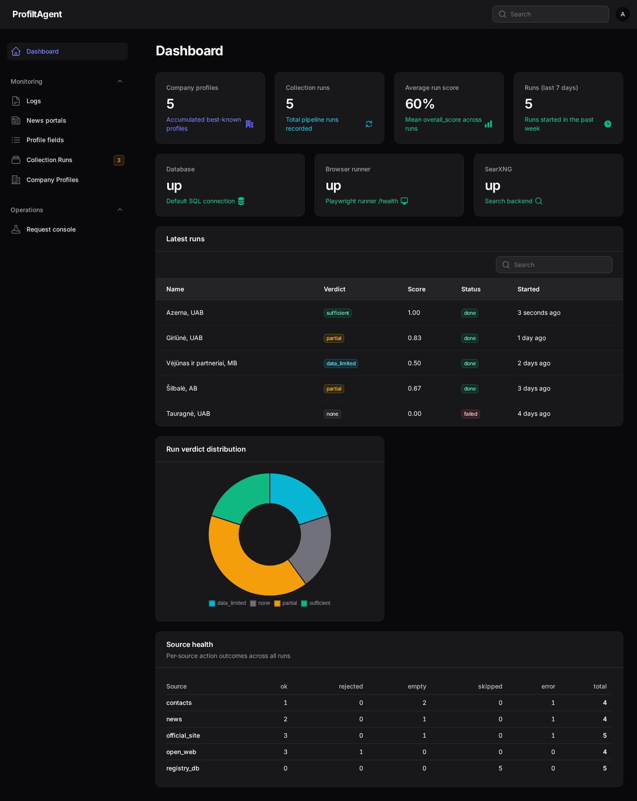
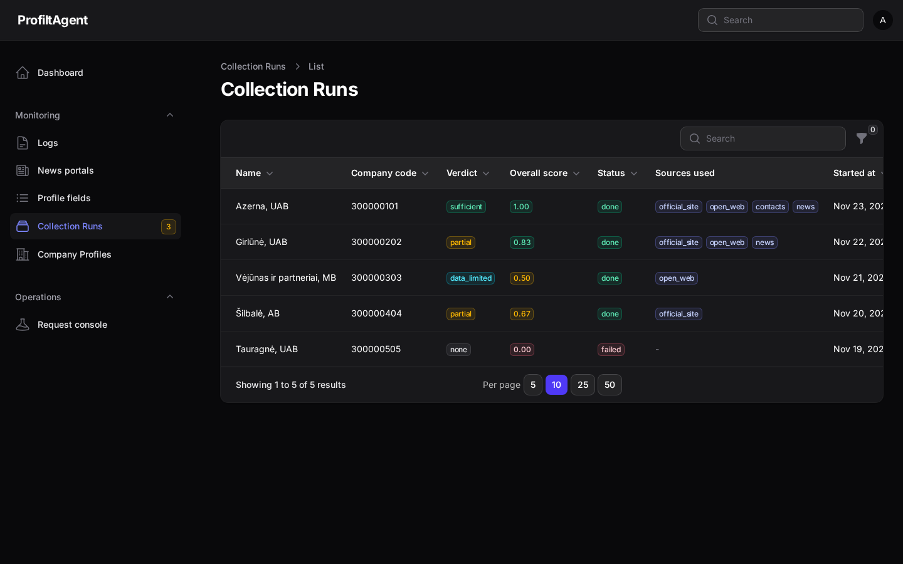
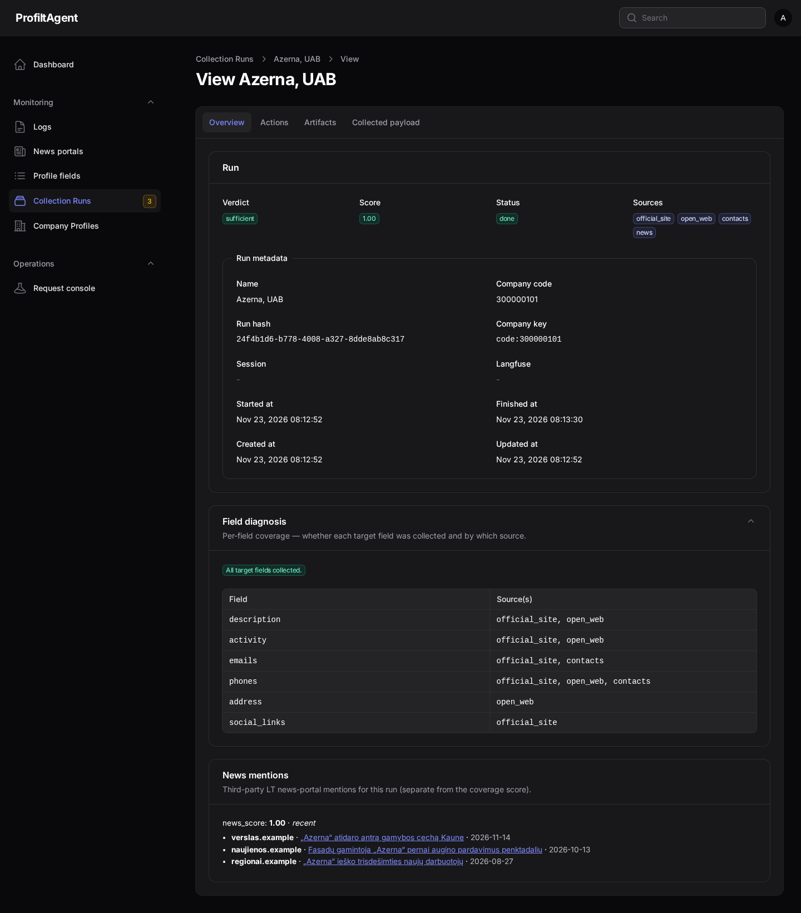
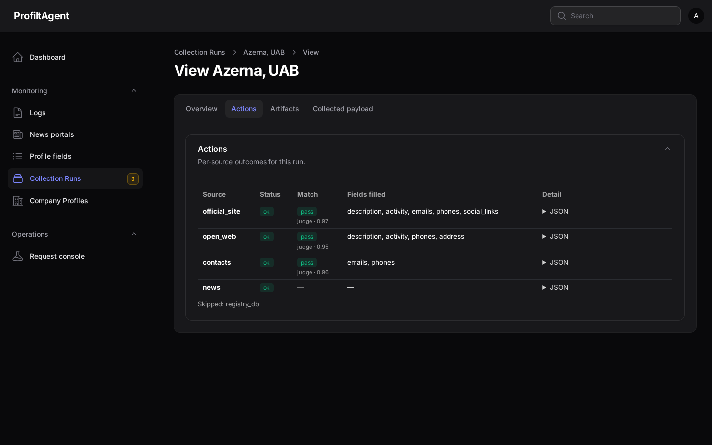
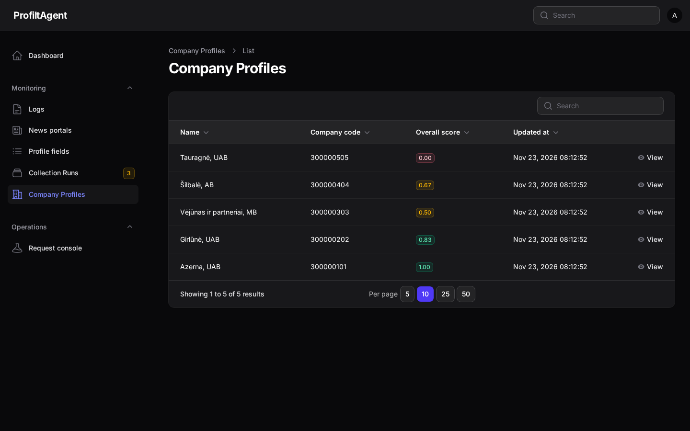
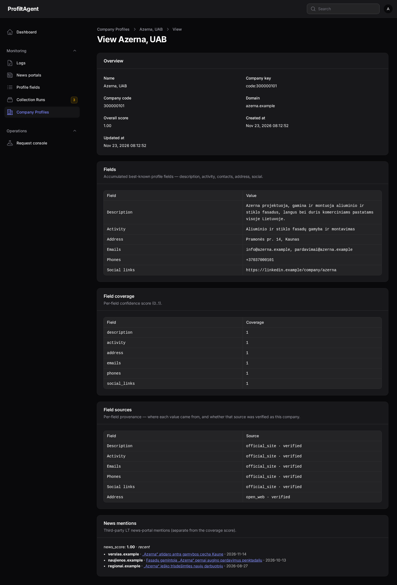
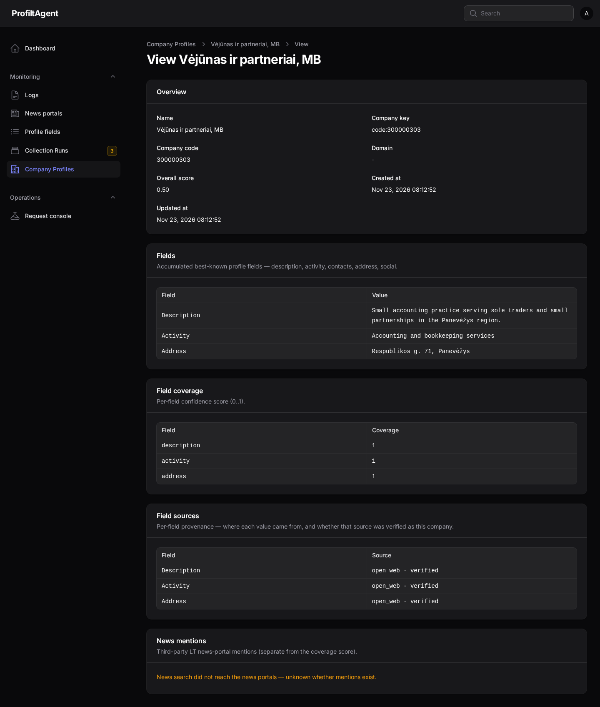
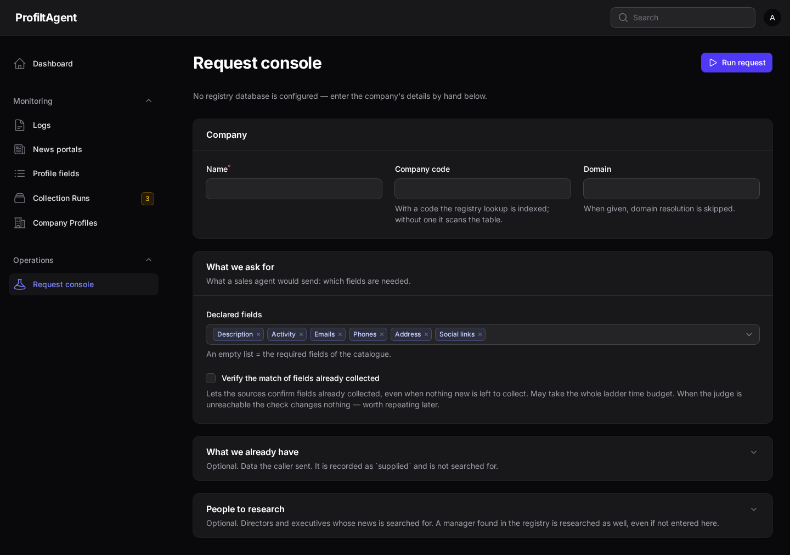
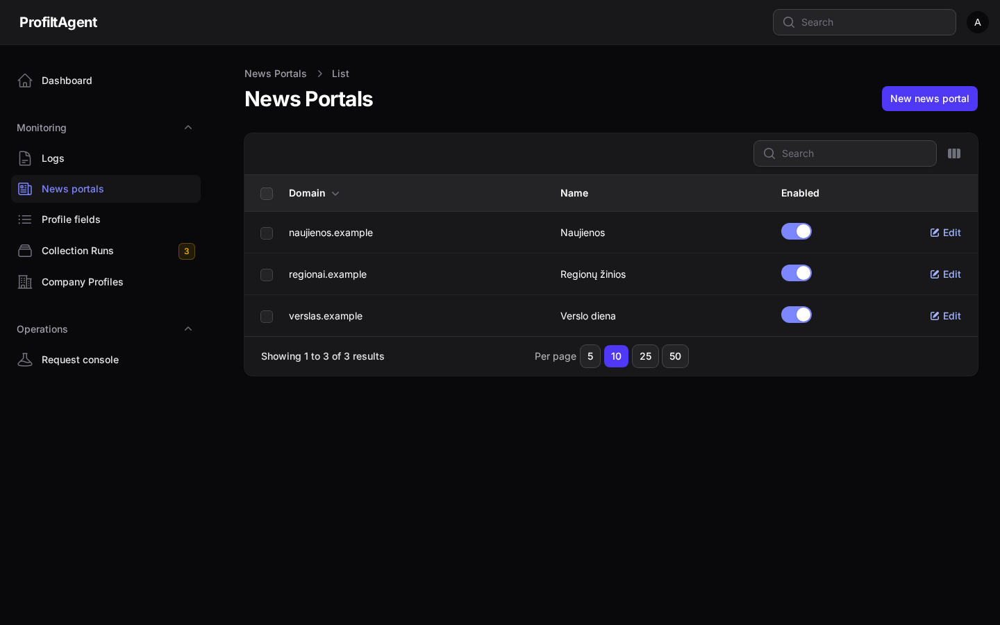
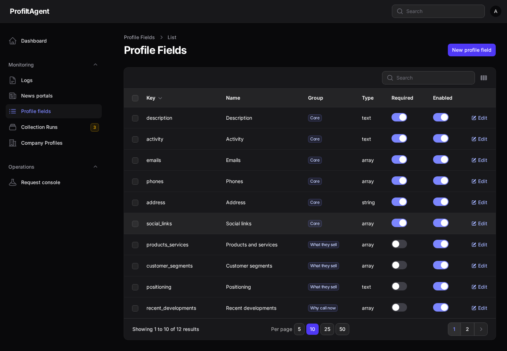

# Admin panel

The Filament panel at `/admin` is where an operator watches collections, tries requests
by hand and maintains the two lists a collection is configured by. The menu has two
groups:

- **Operations** — the [Request console](#request-console), which runs a real
  collection and therefore writes a run and updates the company's profile.
- **Monitoring** — [Collection runs](#collection-runs) and
  [Company profiles](#company-profiles), which are read-only views of what the
  collector stored; [News portals and Profile fields](#news-portals-and-profile-fields),
  which are edited here; and [Logs](#logs).

Runs and profiles cannot be edited by hand anywhere in the panel.

Every company, code, domain, person and article in the screenshots below is invented.
They were produced from demo data, never from collected data — see
[Reproducing the screenshots](#reproducing-the-screenshots).

## Dashboard

Totals, the health of the three things a collection depends on (database, browser
runner, SearXNG), the latest runs, the verdict distribution and per-source outcomes.



## Collection runs

One row per run: verdict, score, status and the sources that contributed. The badge in
the menu counts runs that need attention (failed, a problem verdict, or a low score).
A run whose collection threw is closed as `failed`; it is never left `running`.



A run opens on its overview: the verdict, which source filled which field, and the
news mentions that run found. When the run's news search could not see, the **News
mentions** section says so (see [Company profiles](#company-profiles)).



The **Actions** tab is the audit trail: every source's outcome, the match verdict its
fields were accepted or rejected on, and the full stored detail as JSON.



## Company profiles

The accumulated best-known profile per company.



A profile shows its fields, per-field coverage, and **Field sources**: which source
each stored value came from and whether that source was verified as this company
(`verified`, `unverified` or `unknown` — see [Concepts](concepts.md)).



When the latest run's news search could not see — the backend did not answer, returned
nothing, or ignored the portal filter — the profile shows a warning such as "News search
was not answered by the search backend — unknown whether mentions exist." instead of
reporting that there are no mentions. The exact wording per case is listed in
[Concepts](concepts.md#the-news-search-states).



## Request console

Builds a collection request by hand, runs it, and shows the result. **Run request**
performs the same collection as `POST /api/run`: it records a run and merges what it
finds into the company's profile. With an external registry configured, the **Registry
search** at the top prefills the form; without one the page says so and the fields are
typed in.



## News portals and Profile fields

Both sit in the **Monitoring** group and are the only records edited in the panel;
changes apply to the next collection, without a deploy.

**News portals** is the whitelist the news search is restricted to. A disabled portal
is not searched and its mentions are not counted.

**Profile fields** is the field catalogue: the fields a collection fills, and which of
them are required when a request does not declare its own list.





## Logs

A read-only tail of the application log (`storage/logs/laravel.log` by default;
`LOGVIEWER_PATH` overrides it). The page shows the last 200 lines, read from the final
64 KB of the file, and refreshes every 10 seconds, so a collection can be followed
without shell access. When the file is missing or empty the page says so.

## Colours

The palette is set in one place, `orchestrator/app/Providers/Filament/AdminPanelProvider.php`
(`->colors([...])`): indigo accent on a zinc canvas, cyan for neutral information, and
emerald / amber / rose for success, warning and danger.

## Reproducing the screenshots

`php artisan agent:seed-demo` fills an **empty** database with the invented companies
shown above; it refuses to run when runs or profiles already exist. Point the app at a
fresh database, migrate, seed, create an admin, and capture:

```bash
php artisan migrate:fresh --force
php artisan agent:seed-demo
php artisan agent:create-admin
```

`migrate:fresh` drops every table — never run it against a database that holds
collected data.
