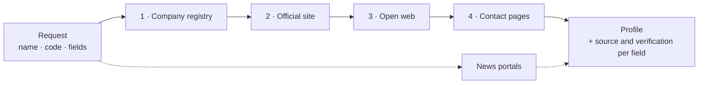
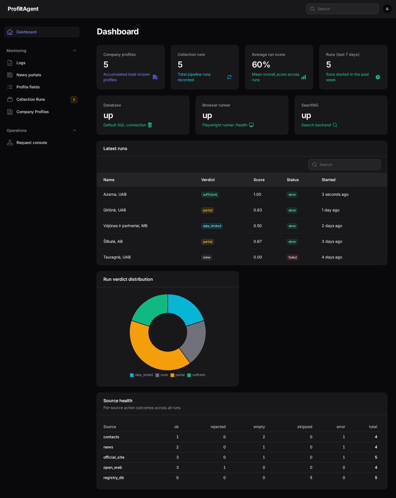
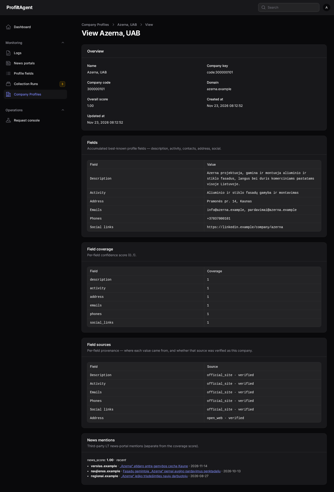
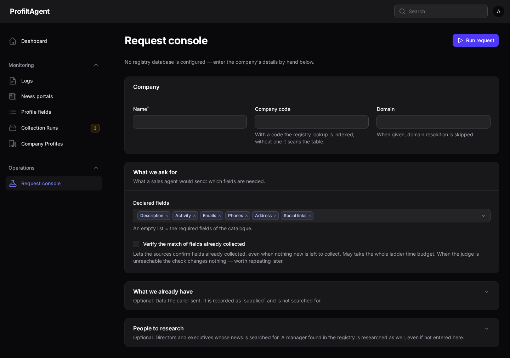

# ProfiltAgent — product overview

ProfiltAgent collects a structured profile of a company on demand. You send a company
name or registry code; it gathers facts from a company registry, the company's own
site, the open web and the news, checks that each source is really about that company,
and returns one profile — with a source and a verification status behind every value.

It is self-hosted: the orchestrator, the browser that reads pages, the search engine and
the admin panel all run in your own infrastructure.

- [The problem it addresses](#the-problem-it-addresses)
- [What goes in and what comes out](#what-goes-in-and-what-comes-out)
- [How a profile is collected](#how-a-profile-is-collected)
- [Why the result can be trusted](#why-the-result-can-be-trusted)
- [News mentions](#news-mentions)
- [Integration: one HTTP call](#integration-one-http-call)
- [The admin panel](#the-admin-panel)
- [Deployment](#deployment)
- [What can be adapted](#what-can-be-adapted)
- [Limits worth knowing](#limits-worth-knowing)
- [Licence and commercial use](#licence-and-commercial-use)

## The problem it addresses

Teams that keep company records — sales, risk, partner management — usually research
them by hand, and three things go wrong:

| | |
|---|---|
| **Scattered** | The registry, the company's own site, business directories and the news each hold one piece of the picture. |
| **Unattributed** | A phone number in the CRM carries no trace of its source, or of whether it belongs to this company or a namesake. |
| **Silent gaps** | "Nothing was found" and "we could not look" end up stored as the same empty field. |

ProfiltAgent automates the research and keeps the two things manual research loses:
where each value came from, and how sure anyone is that it belongs to this company.

## What goes in and what comes out

**You send** a company name, its registry code if you have it, the fields you need, and
anything you already know (which is recorded as supplied and not searched for again).

**You get back** one profile:

| Group | Fields |
|---|---|
| Core (the default) | Description, activity, emails, phones, address, social links |
| On request | Products and services, customer segments, positioning, recent developments, locations, brands |
| Alongside | People (directors and executives), news mentions |
| For every field | Which source it came from, whether that source was verified, and a coverage score |

The field catalogue is editable in the admin panel: which fields exist, which are
required by default, and the hint the extractor is given for each.

## How a profile is collected

Sources are tried in order of trust. Each later source is asked only for what is still
missing, and the run stops as soon as every field you declared is filled.



| # | Source | What it does | Accepted when |
|---|---|---|---|
| 1 | Company registry | Looks the company up by registry code in a registry database you connect. Optional. | Always — it is keyed by code |
| 2 | Official site | Finds the company's domain, then reads the site with a headless browser | Its own quality check does not fail |
| 3 | Open web | Searches and reads third-party pages, such as business directories | An LLM judge agrees the page is about this company |
| 4 | Contact pages | A targeted pass for emails and phone numbers still missing | The page names the company and the judge does not reject it |

Every run ends in one of four verdicts:

| Verdict | Meaning |
|---|---|
| `sufficient` | Every declared field is filled. |
| `partial` | A field is missing, and a source errored or the time budget ran out — a retry may close the gap. |
| `data_limited` | Every source ran cleanly and a field is still missing. This is the company's public-data ceiling, not a failure. |
| `none` | No source contributed anything. |

## Why the result can be trusted

Collecting text from the web is the easy part. The harder question is whether a page
that mentions "Acmena" is about *your* Acmena. ProfiltAgent answers it per source and stores
the answer per field:

| Status | Meaning |
|---|---|
| `verified` | A source confirmed to be about this company established the value. |
| `unverified` | A source contributed the value, but its identity could not be confirmed — for example the judge was unreachable. |
| `unknown` | No verification record exists for this stored value yet. |

`unverified` and `unknown` are kept apart on purpose: the first means something went
wrong and is worth an alert, the second only means nobody has confirmed an older value
yet. The same rule runs through the whole system — it never claims to have looked when
the look could not have worked. [Concepts](concepts.md) defines each term precisely.

## News mentions

News is collected alongside the profile as a separate dimension; it never changes the
coverage score or the verdict.

- Mentions come only from a **portal whitelist** you edit in the admin panel.
- Each mention carries the portal, date, headline, link and an excerpt of the article
  text, and is attributed either to the company or to a named person.
- Topic and tag listing pages are skipped — they name the company but are not articles.
- A search that could not see — the backend did not answer, or ignored the portal
  filter — is recorded on the run as exactly that, never as "no news".

## Integration: one HTTP call

```bash
curl -X POST http://localhost/api/run \
  -H "Content-Type: application/json" \
  -H "X-Api-Key: $AGENT_API_KEY" \
  -d '{
        "company": "Acmena, UAB",
        "code": "300000123",
        "fields": ["description", "activity", "emails", "phones"]
      }'
```

The response, shortened:

```json
{
  "verdict": "sufficient",
  "sources_used": ["official_site", "news"],
  "coverage": { "overall": 1.0, "fields": { "emails": 1.0 } },
  "profile": {
    "description": "…",
    "emails": ["info@acmena.example"],
    "news": {
      "search_state": "answered",
      "mentions": [{ "portal": "naujienos.example", "date": "2026-10-09", "title": "…", "url": "…" }]
    }
  },
  "field_status": { "emails": "found" },
  "field_sources": { "emails": "official_site" },
  "field_verification": { "emails": { "status": "verified" } }
}
```

One request is one company. A run takes from a few seconds, when the stored profile is
already complete, to about a minute for a full pass with news; the default time budget
is 120 seconds. Parameters and response keys are described in the
[integration guide](integration-guide.md) and the [HTTP API reference](api/bootstrap-api.md).

## The admin panel

Operators get a panel at `/admin` that shows every run and what each source did.



A company profile shows the collected fields, per-field coverage and where each value
came from:



The request console builds a request by hand and shows the full result — useful for
checking a company before wiring anything up:



Every screen is walked through in [Admin panel](admin-panel.md).

## Deployment

| | |
|---|---|
| **Self-hosted** | Docker Compose brings up the orchestrator (Laravel), the browser runner (Playwright), the search engine (SearXNG) and the web server. |
| **Your LLM key** | Extraction and the match judge use an LLM through your own API key; Anthropic Claude is the default provider. |
| **Your data** | Profiles, run history and the per-source audit log are stored in your own database. |
| **Well-behaved** | Pages are read by a real browser under a policy file with execution limits. A bot challenge is recorded and respected; it is never solved or bypassed. |

Setup, operation and the ways a deployment can fail quietly are covered in the
[deploy runbook](deploy-runbook.md).

## What can be adapted

ProfiltAgent was built for Lithuanian companies first, and most of what is specific to a
market or a customer is configuration rather than code:

| Area | What changes |
|---|---|
| Field catalogue | Which fields exist, which are required, how each is described to the extractor |
| Registry | Your company registry or CRM as the trusted first source |
| News portals | The whitelist for your market |
| Sources | An additional source specific to your sector |
| Consumer | How results reach your CRM, lead scoring or internal tools |
| Market | Country and language conventions: phone formats, directories, legal forms |

## Limits worth knowing

- **Public data only.** A company with no site and no public footprint ends as
  `data_limited`; that is reported, not hidden.
- **One company per request.** There is no batch endpoint; batches are a loop on the
  caller's side or, with a registry connected, the `agent:enrich-firms` command.
- **Search quality depends on the search backends** you configure for SearXNG.
- **Language.** Lithuanian and English content are handled; other markets need
  adaptation.
- **Personal data.** Profiles can contain names of directors and contact details. What
  you may collect and keep is your responsibility under the law that applies to you;
  [Personal data](personal-data.md) lists what is stored, where it is sent and what the
  software does not do for you.

The complete list is in [Known limitations](known-limitations.md).

## Licence and commercial use

ProfiltAgent is source-available under the
[PolyForm Noncommercial License 1.0.0](../LICENSE). Commercial use — including running
it inside a company — requires a licence from Neuro Momentum, MB, which also provides
integration, deployment and support. See [COMMERCIAL.md](../COMMERCIAL.md).
